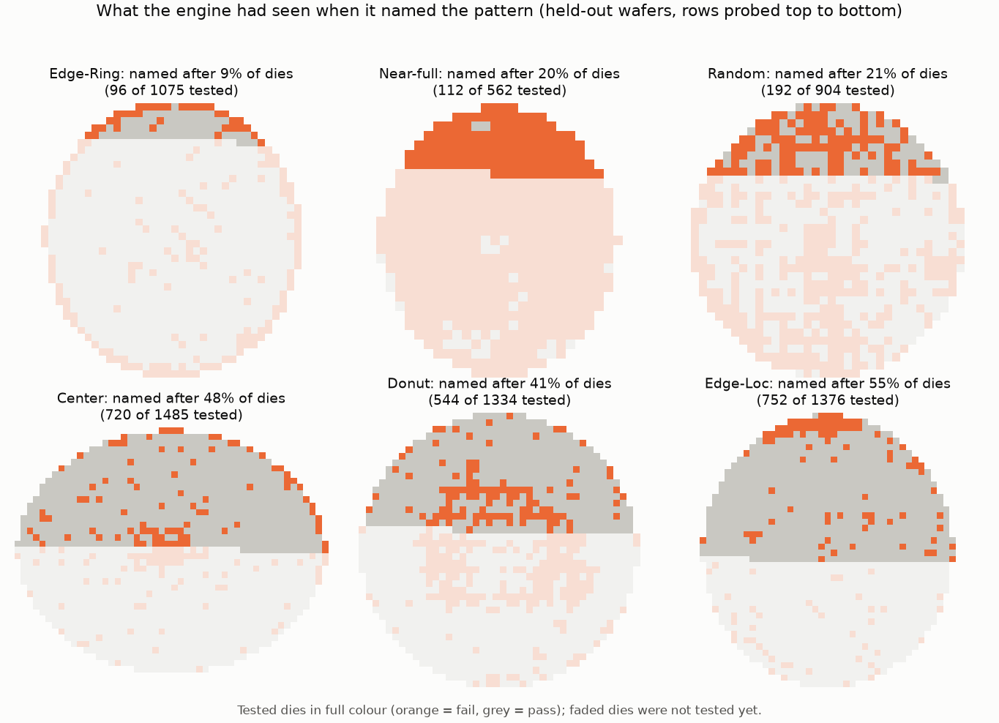
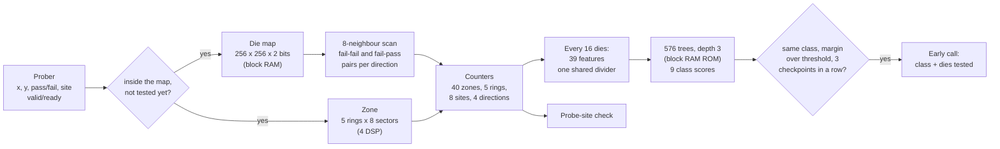
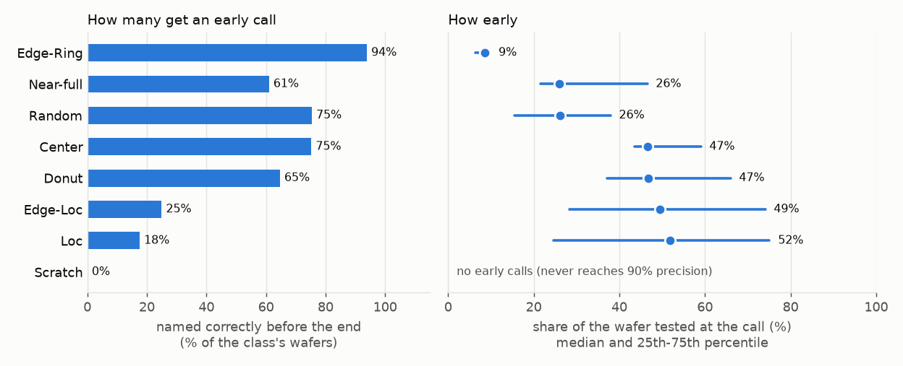
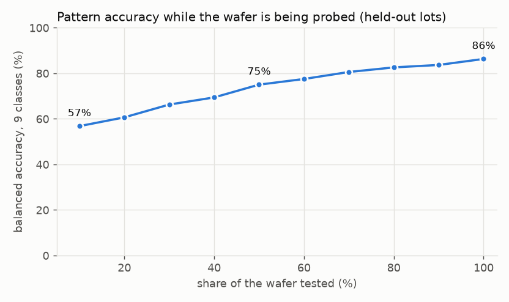

# Early Wafer-Map Pattern Engine (FPGA, SystemVerilog)

A streaming hardware engine that names a wafer's defect pattern **while the wafer is still
being probed**. Dies arrive in prober order. Every 16 dies the engine updates 39 integer
features from what it has seen so far, runs a 576-tree gradient-boosted classifier stored
in block RAM, and calls the pattern (Center, Donut, Edge-Loc, Edge-Ring, Loc, Near-full,
Random, Scratch) as soon as the call is reliable. It also flags a damaged probe site on a
multi-site probe card.

Wafer-map patterns point to different process or handling problems, so knowing the pattern
early tells engineers where to look sooner. Most published classifiers work on the complete
map, after the wafer has been tested. This engine works on the partial map, in the order the
prober tests the dies, and measures how early each pattern can be named.

| | |
|---|---|
| **Data** | WM-811K: 172,950 labeled wafer maps from a real fab. Results below are on 51,839 wafers from 3,228 lots that were not used for training or calibration |
| **Early calls** | 88% of early calls are right; Edge-Ring is named after a median 9% of the dies, Near-full 26%, Random 26%, Center 47%; 1.0% of normal wafers get a false early call |
| **Full map** | 86.3% balanced accuracy over the 9 classes (88.5% plain accuracy) |
| **Probe-site faults** | a site that fails half of its good dies is flagged 99.6% of the time, after a median 17% of the wafer; 0.12% false alarms with a healthy card |
| **Hardware** | meets **100 MHz** on Artix-7 xc7a35t-1 (setup slack +0.63 ns); 2,372 LUTs (11%), 2,304 flip-flops, 10.5 block RAM tiles, 4 DSP; about 285,000 dies per second |
| **Verification** | 25 tests, 6,742 checkpoint records: RTL **bit-identical** to a Python model on every field, with continuous and randomly gapped input; 11 tests repeated on the **routed gate-level netlist**; 400 random cases cross-checked between two independent model implementations |



## How it works



1. **Map and neighbours.** Each accepted die is written into a 2-bit-per-die map. Its 8
   neighbours are read back; every pair of tested neighbours is counted once, as
   fail-fail or fail-pass, separately for the horizontal, vertical and two diagonal
   directions. Dies outside the map and repeated dies (retests) are counted and ignored.
2. **Zones.** The die's ring (centre to edge, 5 rings) and sector (8 octants) come from
   two multiplications that make the elliptical die grid round, and four squared-radius
   thresholds. The host computes these registers once per product from its probe map.
3. **Features.** Every 16 dies: the wafer fail rate, each ring's fail rate, coverage and
   contrast to the wafer, the highest and lowest sector rate in each ring, how
   concentrated the fails are, and four neighbour statistics (does a failing die's
   neighbour also fail; is that direction-dependent, as for a scratch). All 39 are Q.12
   ratios from one sequential divider.
4. **Classifier.** A gradient-boosted ensemble (64 rounds x 9 classes, depth 3), trained
   on partial maps from 5% to 100% tested, quantized to integer thresholds and Q.8
   leaves, and read from block RAM one node per two clocks.
5. **Early-call rule.** A pattern is called when the same class leads for 3 checkpoints
   in a row with a score margin above that class's threshold. The thresholds were set on
   separate calibration lots for 90% precision; Scratch never reached it, so Scratch is
   only named at the end of the wafer.
6. **Probe-site check.** A standard site-to-site comparison: a probe site is flagged when
   its fail rate exceeds the other sites' by a set margin. It runs next to the classifier
   so a tester problem is reported as one, not as a wafer pattern.

The exact rules are in **[docs/ALGORITHM.md](docs/ALGORITHM.md)**.

## Results

All numbers are on the held-out test lots. Wafers of one lot look alike (72% of defect
wafers share their label with another wafer of the same lot), so the split is by lot:
30% of lots for test, and 20% of the remaining lots for calibrating the call thresholds.
WM-811K does not record the probe order, so the dies are fed in a serpentine row order
(top to bottom, alternating direction); E4 repeats the test with a 4-site prober order.
Full tables: [results/eval_tables.md](results/eval_tables.md).

### How early each pattern is named



| class | test wafers | named before the end | right when named | median share of the wafer tested at the call (25th-75th pct.) |
|---|---|---|---|---|
| Edge-Ring | 2,941 | 94% | 86% | **9%** (6-10%) |
| Random | 280 | 75% | 84% | 26% (15-38%) |
| Near-full | 41 | 61% | 83% | 26% (22-47%) |
| Center | 1,319 | 75% | 94% | 47% (43-59%) |
| Donut | 215 | 65% | 90% | 47% (37-66%) |
| Edge-Loc | 1,641 | 25% | 92% | 49% (28-74%) |
| Loc | 1,123 | 18% | 92% | 52% (25-75%) |
| Scratch | 349 | 0% | - | never reaches 90% precision on the calibration lots, so it is named only at the end |

Across all classes, **88% of early calls are right**, and 1.0% of the 43,930 normal wafers
get a false early call. 60% of the defect wafers are named correctly before the end; for
those, the median call comes after 12% of their dies (on average 73% of the wafer is still
untested). The order of the classes follows the probe path: the prober starts at the top
edge, so an edge ring shows up in the first rows, while a centre pattern has to wait until
the probe reaches the middle of the wafer (about half of the dies).

### Accuracy while the wafer is being probed



Balanced accuracy over the 9 classes rises from 57% after 10% of the dies to 75% at half
the wafer and **86.3%** on the full map (88.5% plain accuracy). Full-map recall per class:
Near-full 98%, Random 96%, Edge-Ring 95%, Donut 95%, Center 91%, none 89%, Edge-Loc 82%,
Scratch 68%, Loc 63% (confusion matrix in [results/eval_tables.md](results/eval_tables.md)).

### Other experiments

| experiment | result |
|---|---|
| E4: 4-site (2 x 2) prober order, not used in training | 88% of early calls right, 59% of defect wafers named early, false early calls on 0.98% of normal wafers (serpentine order: 88%, 60%, 0.99%) |
| E5: one damaged probe site (6,000 test wafers, 4-site order) | a site failing 50% of its good dies is flagged on 99.6% of wafers, after a median 17% of the wafer; 100%: 99.9%; 25%: 44%; 10%: 1.3%. Healthy card: 0.12% false alarms. Wrong site: 0.02% or less |
| E6: WM-811K's official train/test split | 69.1% balanced accuracy on full maps (85.3% plain). Its two halves have very different class mixes (for example 8,554 Edge-Ring training wafers vs 1,126 test wafers); the lot split above gives 86.3% |

## Interface

`rtl/wpe_engine_top.sv` (flat ports, the synthesis top) wraps `rtl/wpe_engine.sv`.

| port | dir | meaning |
|---|---|---|
| `clk`, `rst` | in | clock, synchronous active-high reset |
| `cfg_we`, `cfg_addr` [4:0], `cfg_wdata` [35:0] | in | configuration registers (map geometry, checkpoint interval, call thresholds, site check); see the table in [docs/ALGORITHM.md](docs/ALGORITHM.md) |
| `start` | in | one-clock pulse: new wafer (clears the map and the counters) |
| `s_valid`, `s_ready` | in/out | die handshake (AXI-Stream style) |
| `s_x`, `s_y` [7:0], `s_fail`, `s_site` [2:0], `s_last` | in | die position, result, probe site, last die of the wafer |
| `busy`, `done` | out | wafer state; `done` stays high until the next start |
| `ck_valid`, `ck_flat` | out | one checkpoint record per pulse: dies tested, the 39 features, 9 class scores, current class and margin, the early call (class, dies tested), the site flag |

## Run it

Needs Vivado (tested with 2026.1; the free license covers Artix-7) and Python 3 with
numpy, scikit-learn and matplotlib. Set `VIVADO_BIN` if Vivado is not in
`C:\AMDDesignTools\2026.1\Vivado\bin`.

```bash
# 1. download WM-811K (157 MB, from Kaggle) and convert the labeled maps (no pickle.load)
python scripts/get_data.py

# 2. cross-check the per-die model against the vectorized model (random cases)
python model/selftest_models.py 400 --trained

# 3. optional: retrain and recalibrate (the trained ensemble is in the repository)
python scripts/train.py

# 4. RTL regression in Vivado's simulator, continuous and 35% gapped input
python scripts/run_regression.py

# 5. synthesis + place and route, out of context, Artix-7 xc7a35t at 100 MHz
vivado -mode batch -source scripts/build_ooc.tcl -tclargs xc7a35tcpg236-1 10.0 build/impl_100mhz

# 6. same testbench on the routed gate-level netlist (slower; pick tests with --only)
python scripts/run_regression.py --netlist build/impl_100mhz/wpe_engine_funcsim.v --only wm_center_27361,wm_site_fault_64701,single_die,rejects

# 7. evaluation on the held-out lots, figures
python scripts/evaluate.py
python scripts/make_figures.py
```

## Repository layout

| path | contents |
|---|---|
| `rtl/` | `wpe_pkg` (constants, record type), `wpe_zone`, `wpe_div`, `wpe_gbt`, `wpe_engine`, `wpe_engine_top`; tree ROM images `wpe_nodes.mem`, `wpe_leaves.mem` |
| `tb/` | file-driven, self-checking testbench (configuration bus, random input gaps, watchdog) |
| `model/` | per-die bit-exact model (`wpe_model.py`), vectorized model (`wpe_fast.py`), geometry and probe orders, tree ensemble, trained ensemble and thresholds, cross-check |
| `scripts/` | data download and conversion, training, regression runner, Vivado build script, evaluation, figures |
| `docs/` | algorithm specification, figures |
| `results/` | regression and netlist summaries, evaluation tables, Vivado utilization and timing reports |

## Limitations

- **It is a small classifier.** 39 hand-built features and 576 depth-3 trees reach 86%
  balanced accuracy on full maps from held-out lots. Published CNNs report higher numbers
  on complete maps, often with wafer-level random splits, so the numbers are not directly
  comparable; the point of this engine is the partial map, not beating them on full maps.
- **Scratch is never called early**, and Loc and Edge-Loc only for about a fifth of their
  wafers: small or thin patterns need most of the wafer before they stand out.
- **Normal wafers often get a defect label at the end** (11% of them on the full map;
  Scratch precision is 9%) because training balances the classes. The early-call
  thresholds keep false early calls to 1% of normal wafers.
- **Probe order and site faults are simulated.** WM-811K records neither. The classifier
  was trained on one serpentine order; a 4-site order gave the same results, but other
  orders (for example starting at the bottom edge) were not tested.
- **The site check is a standard site-to-site comparison.** It catches a site that fails
  half of its good dies almost every time (99.6%), a quarter on 44% of wafers, and a tenth
  almost never.
- **One result per die**: retests are ignored. Maps up to 256 x 256 (65,536 dies).
- **The die input pauses during a checkpoint** (about 5,400 clocks), so the engine takes
  about 285,000 dies per second at 100 MHz rather than one die per clock. That is far
  above what a prober delivers.
- Tested in simulation and synthesis only; it has not been run on a board.

## Prior work

| work | what it does | difference |
|---|---|---|
| Micron, US 7,010,451 B2 | compares test statistics with limits while the wafer is tested and switches to predefined test-map shapes | no pattern recognition from the partial map; no measure of how early |
| IBM, US 7,962,302 B2 | judges a wafer from fixed sample dies | no pattern type, no use of the probe order; software |
| Dekhovich et al., *Expert Systems with Applications*, 2025 | reinforcement learning chooses which wafer patches to scan, then classifies | free choice of where to look (a prober follows a fixed path); software |
| Kaur and Rama Krishna, *J. Intelligent & Fuzzy Systems*, 2024 | CNN on an FPGA for WM-811K | complete wafer maps only |
| Test-floor rules (windowed bin limits, consecutive-fail alarms, site-to-site checks) | run live during probing | each catches one narrow fault type; none names the spatial pattern |

I did not find a hardware engine that names the wafer-map pattern from a partial map in
prober order and reports how early it can do so. That does not mean none exists.

## Data credit

M.-J. Wu, J.-S. R. Jang and J.-L. Chen, *Wafer Map Failure Pattern Recognition and
Similarity Ranking for Large-Scale Data Sets*, IEEE Transactions on Semiconductor
Manufacturing 28(1), 2015 (WM-811K, MIR Lab, National Taiwan University). Downloaded from
[Kaggle](https://www.kaggle.com/datasets/qingyi/wm811k-wafer-map) by `scripts/get_data.py`;
the data is not included in this repository.

## License

MIT, see [LICENSE](LICENSE).
