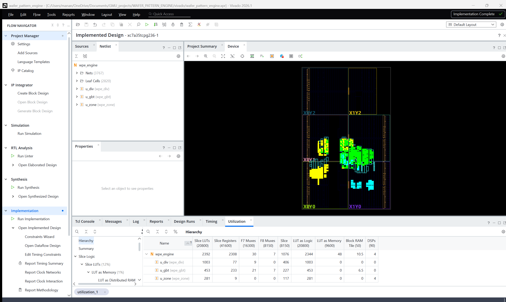
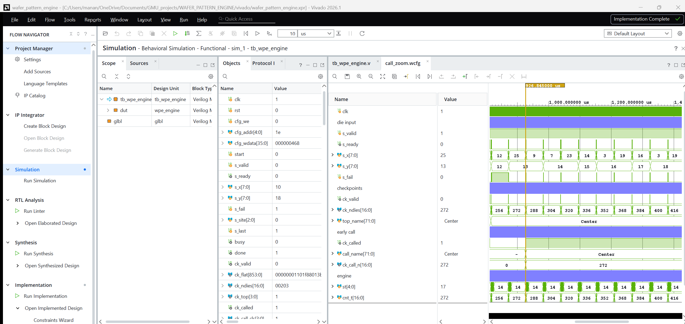
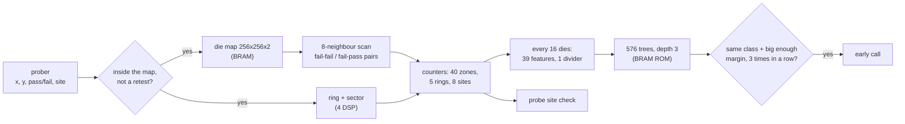

# Wafer pattern engine (Verilog, Vivado)

An FPGA engine that tells you which defect pattern a wafer has while the wafer is still
being probed, instead of after the whole wafer map is done.

At wafer sort the prober tests the dies one by one. The fail pattern on the map (edge ring,
center blob, donut, scratch, ...) points to a different process problem each time, but it
usually only gets classified once the full map exists. This engine takes the die results in
prober order, keeps some running statistics, and every 16 dies runs a small tree-ensemble
classifier that is stored in block RAM. When the same pattern stays on top with a clear
margin for 3 checkpoints in a row it calls it. It also flags a bad probe site on a
multi-site probe card.

Written in Verilog-2001, built and simulated in Vivado 2026.1 (Artix-7). Trained and tested
on WM-811K, 172,950 labeled wafer maps from a real fab. All the numbers below are on lots
that were never used for training.

| | |
|---|---|
| Early calls | right 88% of the time. Edge-Ring gets named after a median of 9% of the dies, Random and Near-full after 26%, Center after 47%. 1% of normal wafers get a wrong early call |
| Full wafer | 86.3% balanced accuracy over the 9 classes |
| Bad probe site | a site that fails half its good dies is caught on 99.6% of wafers, after 17% of the wafer. 0.12% false alarms with a good card |
| FPGA | Artix-7 xc7a35t, meets 100 MHz (WNS +0.709 ns), 2,392 LUTs (11.5%), 2,308 FFs, 10.5 BRAM, 4 DSP |
| Verification | RTL output matches the Python model on every field of 6,742 checkpoint records (25 tests, with and without random gaps on the input), and the post-route netlist matches on 11 of those tests |


## In Vivado

The project comes from `scripts/create_project.tcl`. Synthesis and implementation run out
of context on an Artix-7 xc7a35t at 100 MHz, and Run Simulation plays one real wafer from
the test lots.

Implemented design. Tree ensemble in yellow, divider in green, zone unit in cyan:


Utilization per block. The divider is the biggest because all the feature operands get
muxed into it:



Behavioral simulation of a wafer with a Center pattern. At 926.8 us the engine calls it
Center after 272 of its 515 dies (`ck_called` goes high):



## How it works



1. **Die map and neighbours.** Every die that is inside the map and not a retest gets
   written into a 2 bit per die map. Its 8 neighbours are read back and each pair of tested
   neighbours is counted once, as fail-fail or fail-pass, separately for horizontal,
   vertical and the two diagonals.
2. **Zones.** Ring (centre to edge, 5 rings) and sector (8 octants) of the die. Dies are
   not square so the grid is scaled to come out round first (two multiplies), then r^2 is
   compared with 4 thresholds. The tester computes these registers once per product.
3. **Features.** Every 16 dies: wafer fail rate, fail rate and coverage per ring, highest and
   lowest sector rate per ring, how concentrated the fails are, and some neighbour stats
   (if a die fails, does its neighbour fail too, and does that depend on direction like
   a scratch). 39 features, all Q.12 ratios out of one sequential divider.
4. **Trees.** Gradient boosted trees (64 rounds x 9 classes, depth 3), trained on partial
   maps from 5% to 100% tested, thresholds and leaves turned into integers. One node every
   2 clocks.
5. **Early call.** Same class on top, score margin above that class's threshold, 3
   checkpoints in a row. The thresholds were set on separate calibration lots to get 90%
   precision. Scratch never got there so Scratch is only named at the end.
6. **Probe site check.** Plain site-to-site comparison: a site gets flagged when its fail
   rate is above the other sites by a set amount. It's there so a tester problem doesn't
   get reported as a wafer pattern.

Exact rules: [docs/ALGORITHM.md](docs/ALGORITHM.md)

## Results

Wafers from the same lot look alike (72% of the defect wafers share their label with
another wafer of the same lot) so I split by lot: 30% of the lots for test, 20% of the
rest for calibrating the call thresholds. WM-811K doesn't record the probe order, so the
dies are fed in serpentine order (rows top to bottom, alternating direction).
All tables: [results/eval_tables.md](results/eval_tables.md)

### How early each pattern gets named


| class | test wafers | named before the end | right when named | % of wafer tested at the call, median (25-75%) |
|---|---|---|---|---|
| Edge-Ring | 2,941 | 94% | 86% | 9% (6-10%) |
| Random | 280 | 75% | 84% | 26% (15-38%) |
| Near-full | 41 | 61% | 83% | 26% (22-47%) |
| Center | 1,319 | 75% | 94% | 47% (43-59%) |
| Donut | 215 | 65% | 90% | 47% (37-66%) |
| Edge-Loc | 1,641 | 25% | 92% | 49% (28-74%) |
| Loc | 1,123 | 18% | 92% | 52% (25-75%) |
| Scratch | 349 | 0% | - | never reached 90% precision on the calibration lots |

Overall 88% of the early calls are right and 1% of the 43,930 normal wafers get a wrong
one. 60% of the defect wafers get named correctly before the end, after a median of 12% of
their dies. The order follows the probe path: the prober starts at the top edge so an edge
ring shows up in the first rows, while a center pattern has to wait for the probe to reach
the middle of the wafer.

### Accuracy while the wafer is being probed


Balanced accuracy goes from 57% after 10% of the dies to 75% at half the wafer and 86.3%
at the end (88.5% plain accuracy). Per class at the end: Near-full 98%, Random 96%,
Edge-Ring 95%, Donut 95%, Center 91%, none 89%, Edge-Loc 82%, Scratch 68%, Loc 63%.

### Other tests

| test | result |
|---|---|
| 4-site prober order (2x2 touchdowns), never used in training | 88% of early calls right, 59% of defect wafers named early, 0.98% wrong calls on normal wafers. Basically the same as serpentine |
| one damaged probe site, 6,000 test wafers | site failing 50% of its good dies: caught on 99.6%, after 17% of the wafer. 100%: 99.9%. 25%: 44%. 10%: 1.3%. Good card: 0.12% false alarms |
| WM-811K's own train/test split | 69.1% balanced accuracy on full maps. The two halves have very different class mixes (8,554 Edge-Ring wafers in train, 1,126 in test). The lot split above gives 86.3% |

## Files

| folder | what's in it |
|---|---|
| `rtl/` | `wpe_engine.v` (top), `wpe_zone.v`, `wpe_div.v`, `wpe_gbt.v`, `wpe_defs.vh` (constants, record layout), tree ROMs `wpe_nodes.mem` / `wpe_leaves.mem` |
| `tb/` | `tb_wpe_engine.v`, file driven testbench |
| `constraints/` | 100 MHz clock |
| `sim/` | one WM-811K wafer for the default Vivado simulation, with the expected records |
| `scripts/` | Vivado project script, regression runner, data download, training, evaluation, plots |
| `model/` | Python reference model (per die), fast vectorized version, trained trees |
| `results/` | regression and netlist summaries, evaluation tables, Vivado reports |
| `docs/` | exact rules, figures, Vivado screenshots |

## Running it

Needs Vivado (2026.1 here, the free license covers Artix-7) and Python 3 with numpy,
scikit-learn and matplotlib. If Vivado isn't in `C:\AMDDesignTools\2026.1\Vivado\bin`, set
`VIVADO_BIN`.

```bash
# Vivado project (opens the GUI). Run Simulation plays one Center wafer and prints the call
vivado -source scripts/create_project.tcl

# same thing in batch: synthesis + implementation, reports and routed netlist in build/impl
vivado -mode batch -source scripts/create_project.tcl -tclargs build

# WM-811K (157 MB from Kaggle), needed for the regression and the evaluation
python scripts/get_data.py

# RTL vs Python model, 25 tests, input gaps 0% and 35%
python scripts/run_regression.py

# same testbench on the routed netlist (slow, pick a few tests)
python scripts/run_regression.py --netlist build/impl/wpe_engine_funcsim.v --only wm_center_27361,single_die,rejects

# the two Python models against each other on random cases
python model/selftest_models.py 400 --trained

# evaluation + plots, and retraining if you want (the trained trees are in the repo)
python scripts/evaluate.py
python scripts/make_figures.py
python scripts/train.py
```

## Limitations

- It's a small classifier: 39 hand made features and 576 small trees. Published CNNs get
  higher numbers on complete maps, usually with a random wafer split, so it's not a fair
  comparison. The point here is the partial map.
- Scratch never gets an early call, and Loc / Edge-Loc only for about a fifth of their
  wafers. Small or thin patterns need most of the wafer.
- 11% of the normal wafers get some defect label at the end (Scratch precision is only 9%)
  because training balances the classes. The early-call thresholds keep wrong early calls
  at 1%.
- Probe order and probe site faults are simulated, WM-811K has neither. Trained on one
  serpentine order. The 4-site order gave the same results but other orders (starting at
  the bottom, for example) weren't tested.
- The site check catches a site that fails half its good dies almost every time, a quarter
  on 44% of wafers, a tenth almost never.
- One result per die (retests are ignored), maps up to 256 x 256.
- The die input stalls during a checkpoint (about 5,400 clocks), so it's about 285,000
  dies per second at 100 MHz, not one die per clock. Still way faster than a prober.
- Only simulated and implemented, not run on a board.

## Prior work

| work | what it does | difference |
|---|---|---|
| Micron, US 7,010,451 B2 | checks test statistics against limits during test and switches to predefined test map shapes | doesn't recognise the pattern from the partial map |
| IBM, US 7,962,302 B2 | judges the wafer from fixed sample dies | no pattern type, ignores probe order, software |
| Dekhovich et al., Expert Systems with Applications, 2025 | RL picks which wafer patches to scan, then classifies | free choice of where to look, a prober follows a fixed path; software |
| Kaur and Rama Krishna, J. Intelligent & Fuzzy Systems, 2024 | CNN on an FPGA for WM-811K | complete maps only |
| test floor rules (bin limits, consecutive fail alarms, site-to-site checks) | run live during probing | each one catches one kind of fault, none names the pattern |

I didn't find a hardware engine that names the pattern from a partial map in prober order
and measures how early it can do it, but that doesn't mean there isn't one.

## Data

WM-811K: M.-J. Wu, J.-S. R. Jang and J.-L. Chen, "Wafer Map Failure Pattern Recognition and
Similarity Ranking for Large-Scale Data Sets", IEEE Trans. Semiconductor Manufacturing
28(1), 2015 (MIR Lab, National Taiwan University). `scripts/get_data.py` downloads it from
[Kaggle](https://www.kaggle.com/datasets/qingyi/wm811k-wafer-map), it's not in this repo.

## License

MIT, see [LICENSE](LICENSE).
