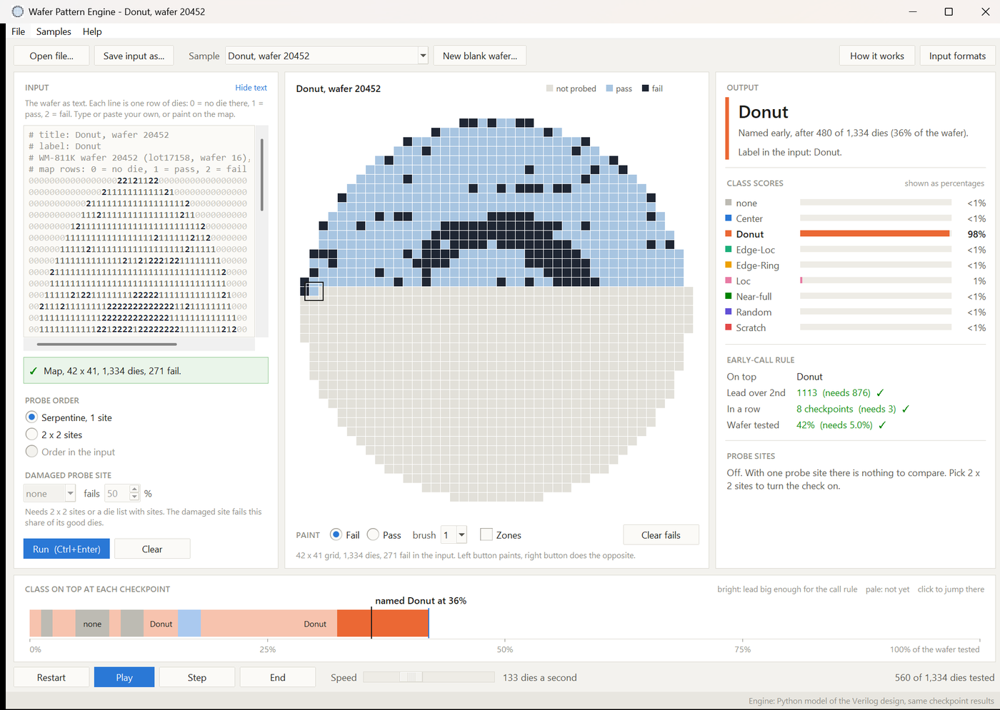
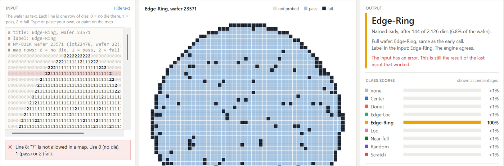
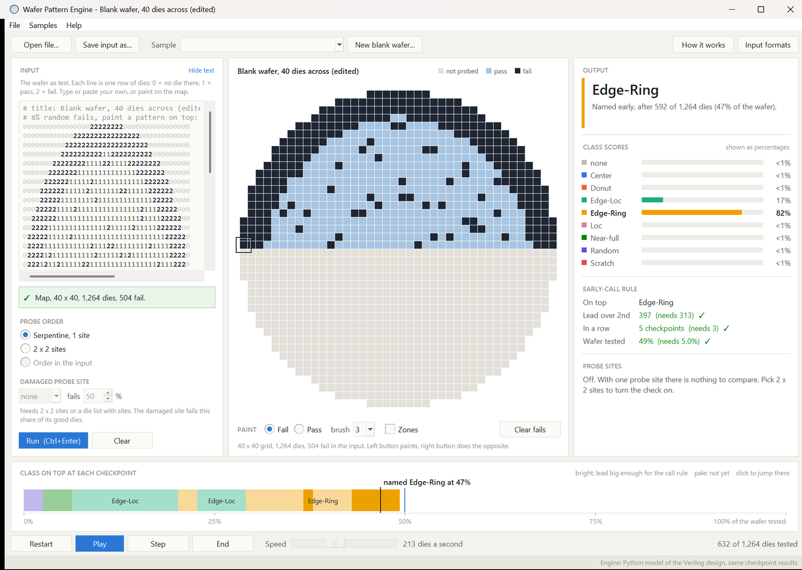

# Part 2: the desktop app

A Windows app for trying the wafer pattern engine without Vivado. You give it a wafer and
it shows what the engine does with it, die by die: which pattern it names, after how many
dies, and why. If something is wrong with the input it tells you what and where.



## Get it

Download `WaferPatternEngine.exe` from the
[latest release](https://github.com/MaNaNchotaliya/WAFER_PATTERN_ENGINE/releases/latest) and
double-click it. It's one file of about 25 MB with Python, numpy, the trained trees and the
sample wafers inside, so there is nothing to install. The exe isn't signed, so the first
time Windows says "Windows protected your PC": click More info, then Run anyway. On a PC
with Smart App Control turned on, Windows blocks unsigned programs completely, so there
you have to run it from the source.

Or run it from the source with Python 3 and numpy (Tk comes with Python):

```bash
python software/wafer_app.py
```

## Using it

The left side is the input: the wafer as text, one line per row of dies, 0 = no die there,
1 = pass, 2 = fail. Type or paste your own, open a file, or pick one of the 11 sample wafers
from the WM-811K test lots. A list of dies in your own probe order (x, y, fail, site) works
too, Help > Input formats has examples. The right side is the output: the pattern the
engine names and after how many dies, the result on the full wafer, the 9 class scores and
where each part of the early-call rule stands.

If something in the input is wrong, the message under the editor says what and on which
line, and that line turns red. The output keeps showing the last input that worked until
it's fixed.

Other things you can do:

- Play, Step and End go through the wafer die by die in probe order. The strip at the
  bottom shows which class was on top at each checkpoint, click it to jump there.
- Paint on the map: left button paints fails, right button paints passes, and the engine
  runs again when you let go. New blank wafer gives you a round wafer with 8% random fails
  to draw on (a normal wafer has about 10%, and with no fails at all the engine is outside
  anything it was trained on).
- Pick 2 x 2 sites and a damaged probe site to see the site check flag it.
- Zones draws the 5 rings and 8 sectors the engine counts fails in.
- File > Run every file in a folder writes one CSV with the result for each wafer file.
- Drag the gaps between the panels to resize them. Hide text hides the input text.





## Same answers as the hardware

The app runs the Python model from `model/`, the same one the Verilog in `vivado/` is
checked against record by record. `check_app.py` makes sure the app gets the same thing:

- `vivado/sim/demo_center.die`, the wafer Vivado's Run Simulation plays, gives exactly the
  register values and the 33 checkpoint records the testbench expects
- all 11 samples with 3 probe settings each give the same records as the per-die model
- bad input gives an error on the right line

```bash
python software/check_app.py
```

## Build the exe

```bash
pip install pyinstaller pillow
python software/build_exe.py       # build/software/dist/WaferPatternEngine.exe
```

## Files

| | |
|---|---|
| `wafer_app.py` | the window |
| `wafer_files.py` | reading the input, running the engine, CSV export. No GUI code |
| `check_app.py` | the checks above |
| `build_exe.py` | one-file Windows build with PyInstaller |
| `samples/` | 11 wafers from the WM-811K test lots, picked by `training/make_app_samples.py` |
| `screenshots/` | the pictures on this page |
