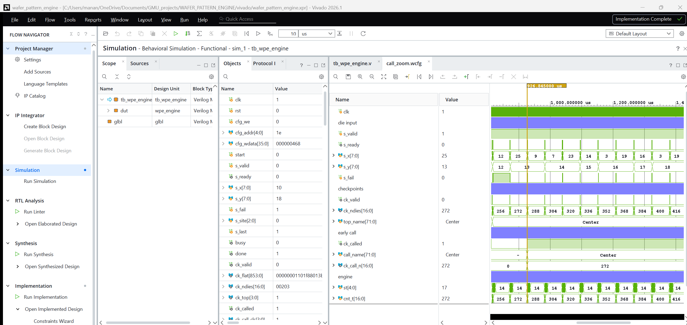
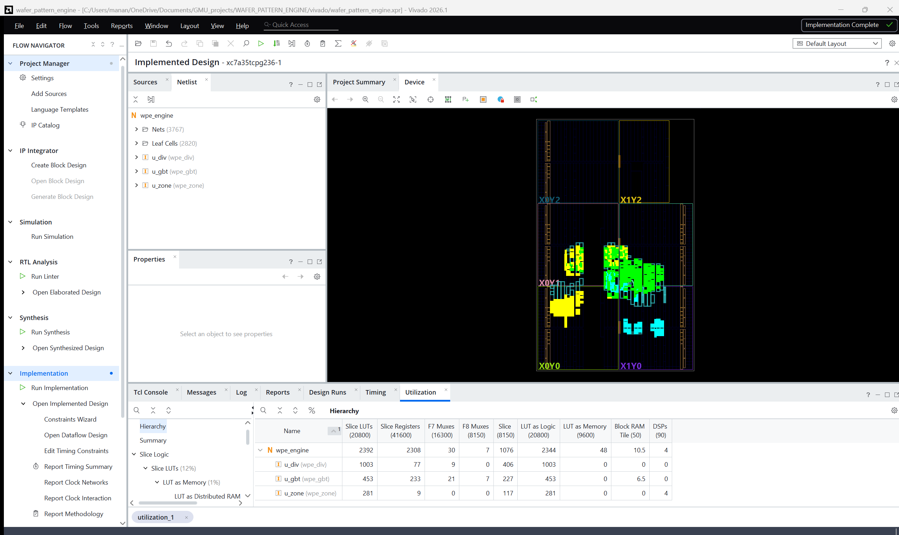

# Part 1: the FPGA design in Vivado

The engine in Verilog-2001, as a Vivado 2026.1 project for an Artix-7 (xc7a35tcpg236-1).
It's built out of context at 100 MHz: it's a block that would sit inside a tester FPGA, so
it has no board top and no I/O pins, and every register-to-register path is timed.

| | |
|---|---|
| Timing | meets 100 MHz, WNS +0.709 ns, WHS +0.135 ns |
| Size | 2,392 LUTs (11.5%), 2,308 FFs, 10.5 BRAM, 4 DSP |
| Speed | about 285,000 dies per second at 100 MHz (the die input stalls during each checkpoint) |
| Verification | 25 tests, 6,742 checkpoint records: RTL == Python model on every field, with and without random gaps on the input. The post-route netlist matches on 11 of the tests |

How the engine works and how well it does are in the [main README](../README.md).

## Open it in Vivado

```bash
vivado -source vivado/create_project.tcl
```

This makes the project in `vivado/project/` and opens it. Run Simulation plays one real
wafer from the test lots with a Center pattern (`sim/demo_center.*`). At 926.8 us
`ck_called` goes high: the engine has named it Center after 272 of its 515 dies.



Implemented design. Tree ensemble in yellow, divider in green, zone unit in cyan:


Utilization per block. The divider is the biggest because all the feature operands get
muxed into it:



Synthesis and implementation in batch, with the reports and the routed netlist written to
`build/impl`:

```bash
vivado -mode batch -source vivado/create_project.tcl -tclargs build
```

The reports from that run are in `results/` (`timing_summary_100mhz.txt`,
`util_hier_100mhz.txt` and so on).

## Check the RTL against the Python model

The regression runs every test wafer through xsim and compares every field of every
checkpoint record with `model/wpe_model.py`. It needs Python 3 with numpy, and WM-811K for
the real wafers (`python training/get_data.py`, 157 MB).

```bash
# 25 tests, input gaps 0% and 35%
python vivado/run_regression.py

# 4 small tests
python vivado/run_regression.py --quick

# the same testbench on the routed netlist (slow, pick a few tests)
python vivado/run_regression.py --netlist build/impl/wpe_engine_funcsim.v --only wm_center_27361,single_die,rejects
```

Last results: [results/regression_summary.txt](results/regression_summary.txt) and
[results/netlist_summary.txt](results/netlist_summary.txt). If Vivado isn't in
`C:\AMDDesignTools\2026.1\Vivado\bin`, set `VIVADO_BIN`.

## Files

| | |
|---|---|
| `rtl/` | `wpe_engine.v` (top), `wpe_zone.v`, `wpe_div.v`, `wpe_gbt.v`, `wpe_defs.vh` (constants, record layout), tree ROMs `wpe_nodes.mem` / `wpe_leaves.mem` |
| `tb/` | `tb_wpe_engine.v`, file driven testbench |
| `constraints/` | 100 MHz clock |
| `sim/` | one WM-811K wafer for the default simulation: registers, die stream and the expected records |
| `create_project.tcl` | makes the project, and with `-tclargs build` also builds it |
| `run_regression.py` | RTL and netlist regression against the Python model |
| `results/` | Vivado timing and utilization reports at 100 MHz, regression and netlist summaries |
| `screenshots/` | the three pictures above |

Vivado's free license covers the Artix-7.
